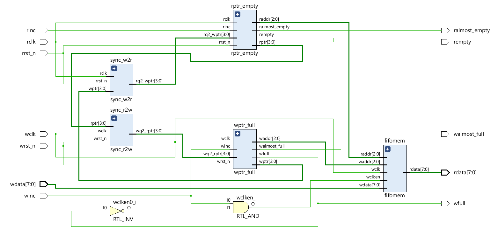
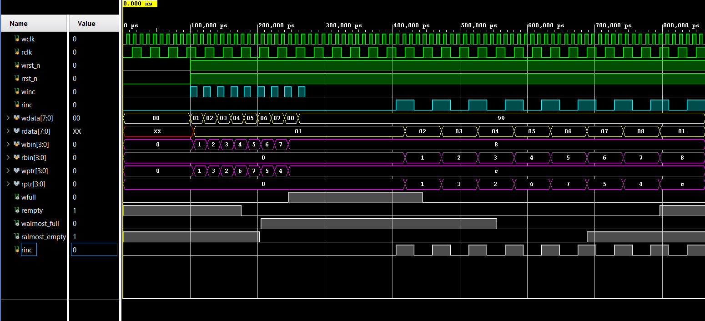

# Asynchronous FIFO (Verilog)

Async FIFO for passing data between two clock domains. I made this to learn CDC.
The design is based on Clifford Cummings' paper "Simulation and Synthesis Techniques
for Asynchronous FIFO Design" (SNUG 2002, style 1). I added almost full and almost
empty flags on top of it.

## Features
- separate write and read clocks
- gray code read/write pointers, 2 flop synchronizers for the crossing
- full, empty, almost full, almost empty flags
- parameters: DATA_WIDTH, ADDR_WIDTH (depth = 2^ADDR_WIDTH), AF, AE

## Files
rtl/
- async_fifo.v - top module
- fifomem.v - dual port memory
- wptr_full.v - write pointer, full and almost full
- rptr_empty.v - read pointer, empty and almost empty
- sync_r2w.v, sync_w2r.v - 2 flop synchronizers

tb/
- tb_async_fifo.sv - testbench

## Block diagram

## How it works (short)
- pointers have one extra bit so full and empty can be told apart
- pointers are converted to gray code before crossing, so only one bit changes at a time
- each side compares its own pointer with the synchronized pointer from the other side
- full is checked in the write clock domain, empty in the read clock domain
- flags are computed from the next pointer value so they are not one cycle late
- flags clear a few cycles late because of synchronizer delay, which is safe

## Simulation
Ran behavioral simulation in Vivado 2025.1 with wclk = 10ns and rclk = 27ns.
The testbench checks: fill until full, write when full is dropped, all data read back
in order, empty, read when empty is ignored, almost full / almost empty at the right
counts. Result: PASS

To run: add the rtl files as design sources and the tb as a simulation source in
Vivado, set tb_async_fifo as top, run behavioral simulation.

## To do
- random test with simultaneous read/write and pointer wraparound
- xdc constraints for the async clocks

## Reference
C. E. Cummings, "Simulation and Synthesis Techniques for Asynchronous FIFO Design",
SNUG San Jose 2002.